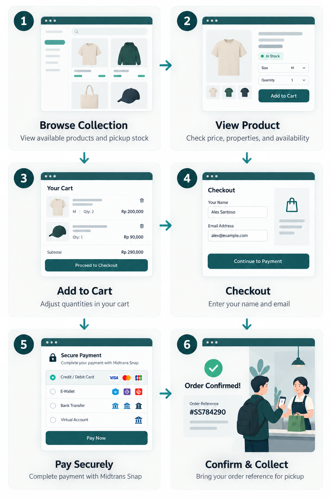

# Supreme Storefront

A responsive web storefront for Supreme ERP. Customers can browse available finished goods, review stock and product details, manage a cart, pay securely with Midtrans, and collect confirmed orders from the facility.

The interface supports light and dark themes. On a first visit it follows the operating system theme; customers can switch themes from the header and their choice is remembered in the browser.

## Features

- Product collection with stock availability and pricing
- Product detail pages and configurable product properties
- Client-side shopping cart with quantity controls
- Midtrans Snap checkout flow and payment-status polling
- Responsive layout for mobile through desktop
- System-aware dark mode with a persistent manual toggle
- Store footer with pickup guidance, navigation, and contact placeholders

## Tech stack

| Area | Installed technology |
| --- | --- |
| UI | React 19 and React DOM 19 |
| Language | TypeScript 5 with strict checking |
| Routing | React Router 7 |
| Styling | Tailwind CSS 4 through the Vite plugin |
| Build tooling | Vite 6 and `@vitejs/plugin-react` |
| UI utilities | Radix Slot, Class Variance Authority, `clsx`, and `tailwind-merge` |
| Icons | Lucide React |
| Payments | Midtrans Snap (loaded during checkout) |
| Testing | Vitest |
| Formatting | Prettier |

## Requirements

- Node.js `>=24 <25`
- npm (a `package-lock.json` is included)
- A running Supreme ERP API, available locally by default at `http://localhost:5000`
- A Midtrans client key for checkout

## Getting started

1. Install dependencies:

   ```bash
   npm install
   ```

2. Create your local environment file:

   ```bash
   cp .env.example .env
   ```

3. Set the values in `.env`:

   ```dotenv
   VITE_API=http://localhost:5000
   VITE_MIDTRANS_CLIENT_KEY=your_midtrans_client_key
   VITE_MIDTRANS_IS_PRODUCTION=false
   ```

4. Start the development server:

   ```bash
   npm run dev
   ```

5. Open the local URL shown by Vite in your browser.

## Environment variables

| Variable | Required | Description |
| --- | --- | --- |
| `VITE_API` | Yes | Base URL of the Supreme ERP API. Defaults to `http://localhost:5000` when omitted. |
| `VITE_MIDTRANS_CLIENT_KEY` | Yes for checkout | Public Midtrans client key used to load the Snap payment widget. Never place a Midtrans server key in this frontend project. |
| `VITE_MIDTRANS_IS_PRODUCTION` | Yes for checkout | Set to `false` for Midtrans Sandbox and `true` for Production. |

## How to use the storefront



1. Open the **Collection** page to view available products and their pickup stock.
2. Select a product to see its price, properties, and availability.
3. Choose **Add to cart**, then adjust quantities or remove items from **Your cart**.
4. Continue to checkout and provide the customer name and email address.
5. Complete the payment in Midtrans Snap.
6. The confirmation page refreshes the payment status automatically. Bring its order reference when collecting the order.

The footer email address, telephone number, location, and pickup hours are demonstration placeholders. Replace them in `src/components/storefront/StorefrontShell.tsx` before deployment.

## API integration

The frontend expects these API routes under `VITE_API`:

| Method | Route | Purpose |
| --- | --- | --- |
| `GET` | `/store/products` | List products for the collection page. |
| `GET` | `/store/products/:id` | Get one product and its properties. |
| `POST` | `/store/checkouts` | Create an order and receive a Midtrans Snap token. |
| `GET` | `/store/checkouts/:reference` | Retrieve order and payment status. |

## Available scripts

| Command | Description |
| --- | --- |
| `npm run dev` | Start the Vite development server. |
| `npm run build` | Type-check the app and create a production build. |
| `npm run preview` | Serve the production build locally. |
| `npm test` | Run the Vitest suite once. |
| `npm run lint` | Run ESLint across the project. |
| `npm run format` | Format files with Prettier. |
| `npm run format:check` | Check formatting without making changes. |

## Project structure

```text
src/
├── components/
│   ├── storefront/    # Header, footer, product cards, order summary
│   └── ui/            # Reusable UI primitives
├── contexts/          # Cart and toast state
├── lib/api.ts         # Supreme ERP API client
├── pages/             # Catalog, product, cart, checkout, confirmation routes
├── App.tsx            # Route definitions
└── index.css          # Tailwind configuration and global theme styles
```
